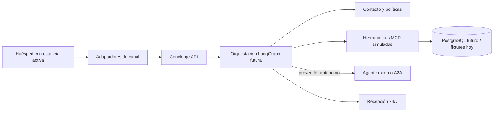

# Luxury Hotel AI Concierge

Fundación de un concierge agéntico para un hotel ficticio de cinco estrellas en Los Ángeles. La Fase 0 define arquitectura, contratos, documentación y datos de demostración; no conecta proveedores reales ni procesa huéspedes o pagos reales.

## Problema y objetivo

El sistema busca reducir cargas operativas repetitivas, en especial after-hours, para huéspedes con check-in realizado y estancia activa. Mantiene una única identidad conversacional a través de adaptadores de voz, WhatsApp y una futura web. Prioriza una experiencia cálida, eficiente, personalizada con permiso, discreta y profesional.

Quedan fuera check-in/check-out, cambios administrativos complejos, verificaciones presenciales, recomendaciones proactivas y cualquier operación física o financiera real.

## Arquitectura

La API de Concierge será el punto de entrada. Un flujo LangGraph futuro normalizará la solicitud, cargará contexto autorizado de estancia, aplicará políticas y decidirá operaciones deterministas, herramientas MCP o escalamiento humano. Los módulos MCP ofrecen capacidades y datos estructurados; no son agentes. A2A se reserva para colaboración con proveedores autónomos independientes, inicialmente el proveedor ficticio de seguridad. Los canales solo adaptan entrada y salida.



### MCP y A2A

MCP expone herramientas deterministas y recursos que el concierge puede invocar con autorización. A2A permite solicitar trabajo a otro agente con lógica, identidad y ciclo de vida propios. Una Agent Card anuncia capacidades y requisitos, pero no prueba por sí misma la identidad: se requiere autenticación y verificación del endpoint. Los contratos describen la intención; los adaptadores actuales son placeholders.

## Capacidades previstas

Información y políticas del hotel; contexto de estancia; suministros nocturnos e intercambio validado por sensores; room service y robots simulados; búsqueda y reservas ficticias de vuelos desde LAX; pagos solo de prueba; transporte ejecutivo con reglas deterministas; colaboración A2A de seguridad; folios y notificaciones consentidas; escalamiento humano. La personalización proactiva queda documentada para una fase futura.

## Agentes

- **Concierge Agent:** Mantiene la conversación con el huésped, carga únicamente el contexto autorizado y coordina herramientas, agentes especializados, confirmaciones y escalamiento.
- **Personal Trainer Booking Agent (prioridad 1):** Consulta el directorio y las tarifas, llama a entrenadores registrados dentro del horario permitido hasta hallar disponibilidad, presenta la opción para aprobación del huésped y coordina una reserva y un pago simulados, sin usar WhatsApp ni correo para contactarlos.
- **Travel Planning Agent (prioridad 2):** Coordina consultas y comparaciones de vuelos, conexiones y transporte según horario, presupuesto y preferencias, propone alternativas ante conflictos y utiliza herramientas MCP para consultas y reservas simuladas.
- **Security Provider Agent (externo vía A2A):** Proveedor ficticio independiente que expone capacidades, disponibilidad, cotizaciones y reservas simuladas mediante A2A con autenticación y verificación del endpoint.

Los agentes especializados comparten solo el contexto necesario, y ninguno confirma un servicio de pago sin autorización explícita del huésped; esta sección documenta contratos y responsabilidades, no lógica funcional.

## Tecnologías y estructura

Python 3.12+, FastAPI, Pydantic 2, SQLAlchemy 2, LangGraph, SDK oficial MCP Python, PostgreSQL futuro, Docker Compose y `uv`. No se fija todavía SDK A2A ni proveedor comercial: se decidirán contra la especificación y necesidades de autenticación al implementar esa integración. Los servicios MCP son módulos del monorepo, no despliegues independientes por defecto.

```text
apps/concierge-api/       API, dominio compartido, futura orquestación y canales
services/                 límites modulares para servidores MCP y proveedor A2A
packages/                 contratos y configuración compartidos
docs/                     decisiones, flujos, arquitectura e integraciones
data/fixtures/            datos ficticios coherentes
infrastructure/           Docker y migraciones futuras
tests/                    contratos, integración y E2E futuros
```

## Requisitos e instalación

Requiere Python 3.12+ y `uv`. Docker es opcional para la base Postgres futura.

```bash
cp .env.example .env
uv sync --project apps/concierge-api --extra dev
uv run --project apps/concierge-api uvicorn concierge.main:app --reload --app-dir apps/concierge-api/src
```

Health check: `GET http://127.0.0.1:8000/health`. La configuración segura de ejemplo no contiene credenciales. Las integraciones no están conectadas; fixtures y adapters stub identifican datos simulados.

Comandos: `make install`, `make run`, `make lint`, `make typecheck`, `make test`. No se ejecuta un modelo conversacional en esta fase.

## Simulación, privacidad y límites

Todos los nombres, tarjetas, importes, reservas, vehículos y folios de `data/fixtures` son ficticios. No enviar información de huésped al proveedor de seguridad: usar un identificador de reserva independiente y revelar lo mínimo necesario. Habitación o caller ID no son autenticación suficiente para acciones sensibles. Confirmar explícitamente transacciones externas; los pagos hoteleros no autorizan compras externas. No guardar PAN, CVV ni secretos en logs. Las herramientas de escritura futuras requieren autorización, idempotencia y auditoría. Los errores de robots o sensores deben detener la liberación física y escalar a un procedimiento seguro.

El estado de folio distingue cargos confirmados, pendientes, autorizaciones, pagos y ajustes. El correo diario es opt-in, máximo uno por día, horario configurable (sugerencia 20:00 hora del hotel); los reenvíos excepcionales requieren recepción. Una tarea programada lo ejecutará, nunca un agente esperando.

## Roadmap

0. Foundation (este repositorio): arquitectura, contratos, fixtures y scaffolding.
1. Concierge Core: LangGraph, contexto autorizado y conversación básica.
2. Hotel Operations: herramientas hoteleras, housekeeping, room service y robots simulados.
3. External Services: vuelos, transporte y Stripe Test Mode.
4. Agent Interoperability: proveedor A2A, Agent Card y autenticación.
5. Guest Experience: WhatsApp, voz, folios, notificaciones y handoff.
6. Quality & Evaluation: pruebas E2E, observabilidad, seguridad y costos.
Futura. Personalización proactiva basada en consentimiento y relevancia.

## Decisiones pendientes

Ver [ADRs](docs/decisions/README.md): versión exacta de protocolo A2A/SDK, autenticación de huésped por canal, proveedor de vuelos/transporte, proveedor de voz y políticas hoteleras definitivas. Los rangos declarados por PyPI/SDK se validarán con lockfile en cada fase.

## Documentación

Empieza en [docs/README.md](docs/README.md), con [alcance](docs/business/scope.md), [arquitectura](docs/architecture/overview.md), [seguridad](docs/architecture/security.md) y [flujos](docs/workflows/).
