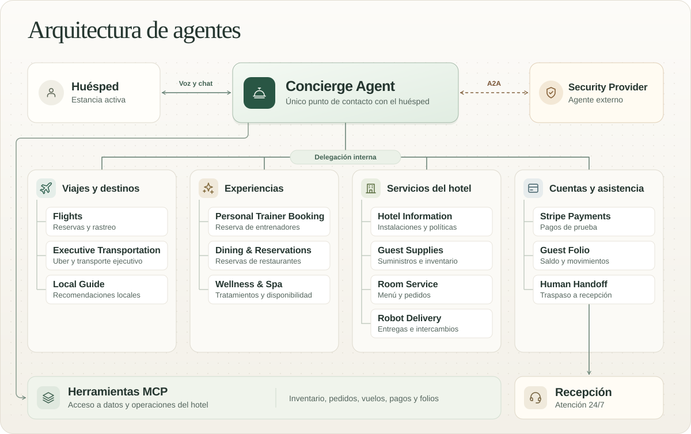

# Luxury Hotel AI Concierge

Un concierge agéntico para un hotel ficticio de cinco estrellas en Los Ángeles, diseñado para atender a huéspedes con una estancia activa y reducir tareas operativas repetitivas, especialmente fuera del horario habitual.

## Problema

Como huésped de un hotel de alto prestigio, quiero acceder a los servicios que ofrece el hotel de forma cómoda, rápida y sencilla, sin tener que averiguar a quién contactar ni repetir mi solicitud. El hotel busca facilitar ese acceso y coordinar con agilidad tareas operativas repetitivas que son importantes para la experiencia del huésped, especialmente fuera del horario habitual. El objetivo es complementar al equipo del hotel, no reemplazarlo: el personal sigue aportando criterio, atención humana y aprobación en los servicios que la requieren.

## Agentes

El **Concierge Agent** es el único punto de contacto del huésped por voz o chat. Verifica el contexto de la estancia, delega la solicitud al especialista adecuado y comunica el resultado o pide la confirmación necesaria.

### Viajes y destinos

- **Flights Agent** busca y compara vuelos, gestiona reservas con confirmación explícita del huésped y rastrea vuelos reservados por el hotel o compartidos por el huésped.
- **Uber / Executive Transportation Agent** consulta disponibilidad y coordina transporte ejecutivo simulado.
- **Local Guide Agent** prepara recomendaciones de restaurantes, actividades y sitios turísticos seleccionados por el hotel, con descuentos cuando estén disponibles.

### Experiencias

- **Personal Trainer Booking Agent** busca entrenadores registrados por especialidad, tarifa y preferencias y los contacta exclusivamente por teléfono dentro del horario permitido hasta encontrar disponibilidad. Devuelve la opción al concierge y, tras la aprobación del huésped, registra la reserva y el pago simulados.
- **Dining & Reservations Agent** cruza preferencias y disponibilidad en la red de restaurantes del hotel. Prepara solicitudes de reserva que requieren aprobación humana.
- **Wellness & Spa Agent** consulta tratamientos, profesionales y horarios. Coordina solicitudes de bienestar que requieren aprobación humana.

### Servicios del hotel

- **Hotel Information Agent** consulta información estructurada sobre instalaciones, políticas, servicios y horarios y disponibilidad de limpieza general.
- **Guest Supplies Agent** verifica inventario y gestiona solicitudes permitidas de suministros.
- **Room Service Agent** consulta el menú, registra pedidos simulados y devuelve su estado según el horario del servicio.
- **Robot Delivery Agent** coordina entregas e intercambios simulados según la disponibilidad del robot y las validaciones de seguridad.

### Cuentas y asistencia

- **Stripe Payments Agent** coordina pagos en Stripe Test Mode y exige autorización explícita del huésped.
- **Guest Folio Agent** consulta el saldo y los movimientos de la estancia y distingue cargos confirmados de pendientes.
- **Human Handoff Agent** deriva solicitudes a recepción y devuelve al concierge el estado del traspaso.

### Herramientas y conexiones externas

- **Herramientas MCP.** Exponen operaciones del hotel, como consultar inventario o folios. El concierge y los especialistas pueden invocar las herramientas autorizadas para su tarea.
- **Security Provider Agent.** Es el agente del proveedor ficticio e independiente de seguridad. El concierge se comunica con él por A2A después de verificar el endpoint y la autenticación.
- **Recepción.** El equipo del hotel atiende solicitudes escaladas y conserva las decisiones que requieren intervención humana.

La Fase 0 contiene la base de la API y su health check. La [guía de arquitectura](docs/architecture/overview.md) explica cómo se conectarán estos componentes y dónde se aplicarán los permisos y las aprobaciones.
