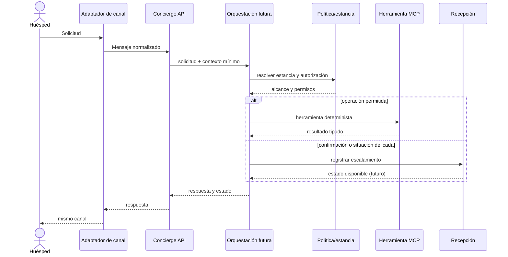

# Arquitectura general

## Límites

El sistema atiende únicamente estancias activas. Los canales convierten voz, WhatsApp y web a un contrato de mensaje común y retornan la respuesta por el mismo canal. Una sola identidad de concierge coordina solicitudes. La API aloja primero un monolito modular; los módulos de servicio no se despliegan aparte solo por ser herramientas MCP.

## Capas

1. **Canales**: adaptadores de transporte; WhatsApp valida firma y consentimiento, voz no promete transferencia sin integración.
2. **API**: autenticación del canal, validación de entrada y health check.
3. **Orquestación**: LangGraph futuro con estado tipado, persistencia y nodos deterministas. Una llamada al modelo solo cuando interpretar lenguaje ambiguo aporte valor.
4. **Dominio**: políticas, permisos, estados e invariantes; importes y conflictos se calculan determinísticamente.
5. **Puertos**: interfaces para hotel, inventario, pedidos, pagos, vuelos, flota, folios, notificaciones y proveedor externo.
6. **Adaptadores**: fixture/local primero; proveedor real solo en fases futuras y etiquetado como tal.

## Estado y persistencia

El contexto recuperable se limita al ID de conversación, canal, ID de estancia y resultados mínimos. No guardar PAN/CVV ni expedientes en el estado de modelo. PostgreSQL es el destino previsto para entidades de negocio y auditoría; el backend de checkpoint de LangGraph y retención quedan por seleccionar. Los eventos de auditoría estarán separados de logs técnicos.

## Flujo de solicitud

No habrá handoff telefónico simulado hasta tener una integración de telefonía real. En Fase 0 solo existe health check.
