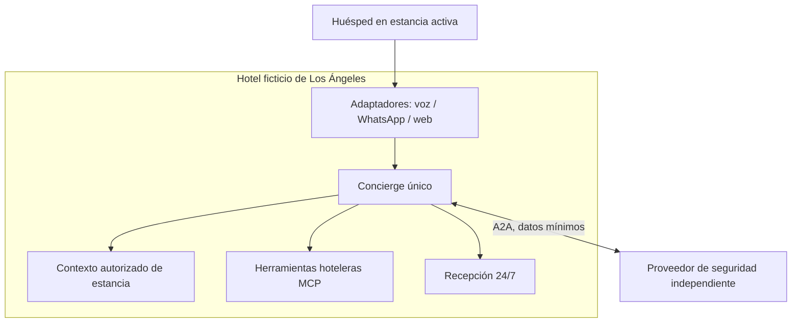

# Contexto del sistema

El huésped autenticado conversa con el Concierge API por un adaptador de canal. El sistema consulta fuentes administradas por el hotel y herramientas operativas simuladas. Cuando se requiera un proveedor autónomo de protección, el sistema lo tratará como organización independiente mediante A2A. Recepción está disponible 24/7 y conserva las verificaciones presenciales y decisiones fuera de política.

