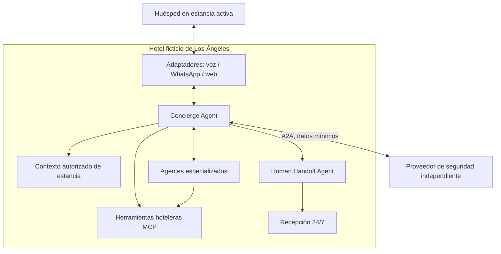

# Contexto del sistema

El huésped autenticado conversa con el Concierge Agent a través del adaptador de canal. El concierge consulta el contexto autorizado de la estancia y coordina a los especialistas internos. Recepción está disponible 24/7 y conserva las verificaciones presenciales y las decisiones fuera de política. El proveedor externo de seguridad opera como una organización independiente. [Guía de arquitectura](overview.md)

